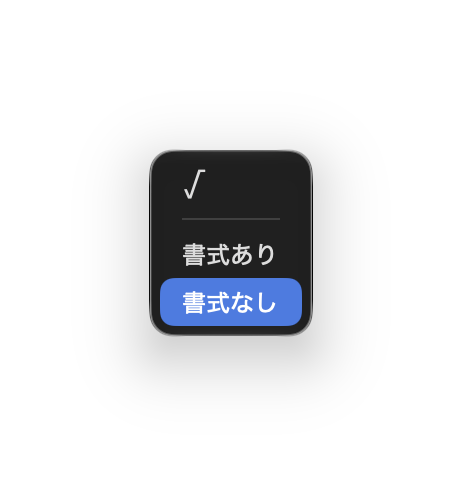

# interpaste

Macでペーストの書式を選ぶ常駐アプリです。

`⌥V`(Option + V)を押すと、画面の中央にメニューが出ます。貼り付けたい形式を選ぶと、その形式で貼り付けます。

- **√**:√ を入力します(本来 ⌥V で入力される文字です)
- **書式あり**:書式付きのまま貼り付けます
- **書式なし**:文字だけを貼り付けます
- **PNG など**:画像をコピーしているときは、画像のプレビューとフォーマットが出ます

`⌘V` は従来通り使えます。



## インストール

```bash
curl -fsSL https://raw.githubusercontent.com/minor-mn/interpaste/main/scripts/install.sh | sh
```

起動すると、画面上部のメニューバーに常駐します。

最初の一度だけ「アクセシビリティ」の許可を求められるので許可してください。クリップボードに触れる上で避けられない許可です。

不安な方は、ソースコードを AI に読ませてみて、おかしなところが無いか尋ねてください。インストールスクリプトがしているのは、このリポジトリのソースコードから GitHub Actions でビルドされたアプリをダウンロードして、「アプリケーション」フォルダーに置くことだけです。

## 設定

Mac の起動時に interpaste を起動するには、システム設定の「一般」→「ログイン項目と機能拡張」で「+」ボタンを押して、interpaste を追加します。
